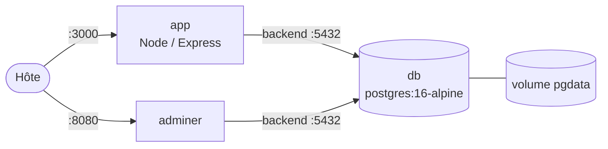
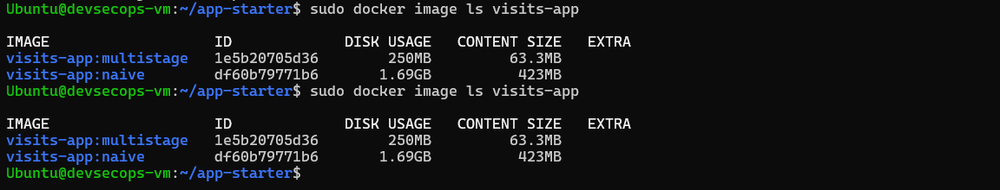
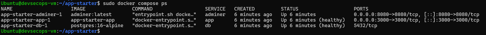
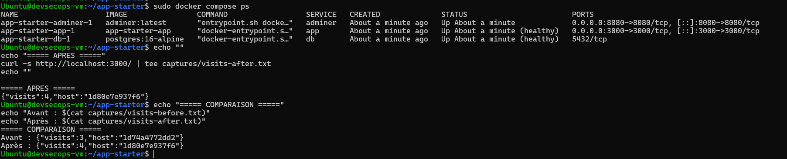

# TP7 — Docker avancé et Docker Compose

Application Node.js/TypeScript qui compte les visites dans PostgreSQL, déployée avec Docker Compose (`app` + `db` + `adminer`). L'image est multi-stage, optimisée, exécutée en non-root, avec un `HEALTHCHECK`.

## Sommaire

- [Architecture](#architecture)
- [Démarrage rapide](#démarrage-rapide)
- [Structure du projet](#structure-du-projet)
- [Comparaison des images](#comparaison-des-images)
- [Analyse des vulnérabilités](#analyse-des-vulnérabilités)
- [Docker Compose](#docker-compose)
- [Persistance](#persistance)
- [Buildx multi-architecture](#buildx-multi-architecture)
- [Défi : reverse proxy Nginx](#défi--reverse-proxy-nginx)
- [Livrables](#livrables)

---

## Architecture



| Service | Image | Réseaux | Port publié |
|---|---|---|---|
| `app` | build local (multi-stage) | frontend + backend | `3000` |
| `adminer` | `adminer:4` | frontend + backend | `8080` |
| `db` | `postgres:16-alpine` | backend (`internal: true`) | **aucun** |

`db` n'est joignable que depuis les autres conteneurs : le réseau `backend` est `internal`, donc sans accès sortant et sans port publiable.

---

## Démarrage rapide

```bash
# 1. Cloner
git clone <url-du-repo>
cd tp7-docker-compose

# 2. Créer le .env à partir du template
cp .env.example .env
# éditer .env et choisir un mot de passe fort

# 3. Lancer la pile
docker compose up -d --build

# 4. Vérifier
docker compose ps                  # db et app : (healthy)
curl http://localhost:3000/health
curl http://localhost:3000/

# 5. Arrêter (données conservées)
docker compose down

# 6. Arrêter ET supprimer les données
docker compose down -v
```

---

## Structure du projet

```
tp7-docker-compose/
├── .gitignore
├── .dockerignore
├── .env.example
├── README.md
├── Dockerfile
├── Dockerfile.naive
├── compose.yaml
├── nginx.conf              (défi)
├── package.json
├── package-lock.json
├── tsconfig.json
├── src/
│   └── server.ts
└── captures/
```

| Fichier | Rôle |
|---|---|
| `src/server.ts` | API Express : `GET /` (compteur de visites) et `GET /health` |
| `Dockerfile` | Multi-stage (deps / build / runtime), utilisateur `node`, `HEALTHCHECK` |
| `Dockerfile.naive` | Version naïve, point de comparaison |
| `.dockerignore` | Exclut `node_modules`, `dist`, `.git`, `.env`, `Dockerfile*`, `compose.yaml` |
| `compose.yaml` | Pile `db` + `app` + `adminer`, réseaux `frontend`/`backend`, volume `pgdata` |
| `.env.example` | Template des variables, sans valeur sensible |

---

## Comparaison des images

| Indicateur | naive | multistage |
|---|---|---|
| Taille de l'image | ~1,69 Go | ~150–200 Mo **(≈)** |
| Build à froid | ~3 min 50 s | ~2–3 min **(≈)** |
| Build après modification de `src/` | `npm install` réexécuté (~10–15 s) | `npm ci` en `CACHED` (~3–8 s) **(≈)** |
| Utilisateur | `root` (uid=0) | `node` (uid=1000) |
| Vulnérabilités HIGH/CRITICAL | 488 | 6 |



*`docker image ls visits-app` : l'image multi-stage est environ 10 fois plus petite.*


*`docker run --rm visits-app:multistage id` → `uid=1000(node) gid=1000(node)`.*

### Pourquoi la version naïve réexécute `npm install`

Dans `Dockerfile.naive` :

```dockerfile
COPY . .           # invalide le cache dès qu'un fichier source change
RUN npm install    # donc réexécuté à chaque modification
```

Dans le multi-stage, `package*.json` est copié avant les sources :

```dockerfile
COPY package*.json ./
RUN npm ci         # CACHED tant que package-lock.json ne change pas
COPY . .           # seule cette couche est invalidée
```

### Preuve du cache

Après modification de `src/server.ts` et rebuild :

```
#6 CACHED
#7 CACHED
#8 CACHED
#9 CACHED
```

L'étape `npm ci` reste en cache : le build à chaud prend quelques secondes.

---

## Analyse des vulnérabilités

Scan avec [Trivy](https://trivy.dev/) :

```bash
trivy image --severity HIGH,CRITICAL visits-app:naive
trivy image --severity HIGH,CRITICAL visits-app:multistage
```

### Image naïve

| Écosystème | Total | HIGH | CRITICAL |
|---|---|---|---|
| Debian 12.15 | 482 | 462 | 20 |
| Node.js (`package.json`) | 6 | 6 | 0 |
| **Total** | **488** | **468** | **20** |

Causes :
- Base `node:24` (Debian complète, ~1 Go) avec environ 200 paquets OS inutiles (ImageMagick, MariaDB, OpenEXR, kernel headers…).
- `npm install` sans `prune` : les devDependencies restent présentes.
- Exécution en **root** : toute CVE d'escalade est exploitable.

### Image multi-stage

| Écosystème | Total | HIGH | CRITICAL |
|---|---|---|---|
| Alpine 3.21 | 0 | 0 | 0 |
| Node.js (`package.json`) | 6 | 6 | 0 |
| **Total** | **6** | **6** | **0** |

Améliorations :
- Base `node:24-alpine` : environ 15 paquets OS au lieu de 200.
- `npm prune --omit=dev` : devDependencies supprimées.
- `USER node` : les CVE d'escalade de privilèges sont beaucoup moins exploitables.

### Les 6 HIGH restantes (communes aux deux images)

| Package | CVE | Correctif |
|---|---|---|
| `brace-expansion` | CVE-2026-102276, CVE-2026-102278 | mise à jour vers la version corrigée |
| `undici` | CVE-2026-109383, CVE-2026-109869, CVE-2026-19534, CVE-2026-87018 | mise à jour vers la version corrigée |

Elles viennent de `package.json` (dépendances directes ou transitives), pas de l'OS. Elles se corrigent avec `npm audit fix` ou une mise à jour manuelle.

---

## Docker Compose

### `compose.yaml`

```yaml
name: tp7

services:
  db:
    image: postgres:16-alpine
    restart: unless-stopped
    environment:
      POSTGRES_USER: ${POSTGRES_USER:?définir POSTGRES_USER dans .env}
      POSTGRES_PASSWORD: ${POSTGRES_PASSWORD:?définir POSTGRES_PASSWORD dans .env}
      POSTGRES_DB: ${POSTGRES_DB:?définir POSTGRES_DB dans .env}
    volumes:
      - pgdata:/var/lib/postgresql/data
    healthcheck:
      test: ["CMD-SHELL", "pg_isready -U $${POSTGRES_USER} -d $${POSTGRES_DB}"]
      interval: 5s
      timeout: 3s
      retries: 5
    networks: [backend]

  app:
    build: .
    image: visits-app:multistage
    restart: unless-stopped
    environment:
      PGUSER: ${POSTGRES_USER}
      PGPASSWORD: ${POSTGRES_PASSWORD}
      PGDATABASE: ${POSTGRES_DB}
      PGHOST: db
      PGPORT: 5432
    ports: ["3000:3000"]
    depends_on:
      db:
        condition: service_healthy
    networks: [frontend, backend]

  adminer:
    image: adminer:4
    restart: unless-stopped
    environment:
      ADMINER_DEFAULT_SERVER: db
    ports: ["8080:8080"]
    depends_on:
      db:
        condition: service_healthy
    networks: [frontend, backend]

volumes:
  pgdata:

networks:
  frontend:
  backend:
    internal: true
```

### Points clés

| Point | Implémentation | Preuve |
|---|---|---|
| Isolation réseau | `db` sans `ports:`, réseau `backend` en `internal: true` | `docker compose ps` affiche `5432/tcp` (pas de `0.0.0.0:5432`) |
| Ordre de démarrage | `depends_on: condition: service_healthy` | `app` démarre seulement quand `db` est healthy |
| Healthcheck `db` | `pg_isready` toutes les 5 s | `(healthy)` dans `compose ps` |
| Healthcheck `app` | `HEALTHCHECK` dans le Dockerfile | `(healthy)` dans `compose ps` |
| Volume nommé | `pgdata:/var/lib/postgresql/data` | données conservées après `down` / `up` |
| Variables d'environnement | `.env` (ignoré) + `.env.example` (versionné) | `docker compose config` |



*`db` et `app` sont `(healthy)`. `db` n'expose aucun port sur l'hôte.*

### Questions du TP

**Que fait `docker compose down -v` par rapport à `down` ?**
`down` supprime les conteneurs et les réseaux mais conserve les volumes nommés. `down -v` supprime aussi les volumes nommés, donc **toutes les données PostgreSQL sont perdues**.

**Que se passe-t-il avec `--scale app=2` et `ports: "3000:3000"` ?**
Un port de l'hôte ne peut être lié qu'à un seul conteneur. Le second réplica échoue avec `port is already allocated`.
Solutions :
1. Retirer `ports` de `app` et passer par un reverse proxy Nginx (voir le défi).
2. Utiliser une plage de ports : `"3000-3001:3000"`.
3. Utiliser un load balancer externe.

---

## Persistance



*Après `docker compose down` puis `up -d`, le compteur passe de 3 à 4.*

```
Avant : {"visits":3,"host":"1d74a4772dd2"}
Après : {"visits":4,"host":"1d80e7e937f6"}
```

- Le `host` change : c'est un nouveau conteneur.
- Le compteur continue : les données ont survécu grâce au volume `pgdata`.

Vérification du volume :

```bash
docker volume ls | grep pgdata
docker volume inspect tp7_pgdata
```

---

## Buildx multi-architecture

```bash
# Émulation arm64
docker run --privileged --rm tonistiigi/binfmt --install arm64

# Builder multi-arch
docker buildx create --name multiarch --use
docker buildx inspect --bootstrap

# Build + push
docker login
docker buildx build --platform linux/amd64,linux/arm64 \
  -t <utilisateur>/visits-app:1.0.0 --push .

# Vérification
docker buildx imagetools inspect <utilisateur>/visits-app:1.0.0
```

Résultat attendu :

```
Name:      docker.io/<utilisateur>/visits-app:1.0.0
MediaType: application/vnd.oci.image.index.v1+json

Manifests:
  Platform:  linux/amd64
  Platform:  linux/arm64
```


*L'image est publiée pour `linux/amd64` et `linux/arm64`.*

---

## Défi : reverse proxy Nginx

Objectif : placer Nginx devant `app`, scaler à 3 réplicas, et ne publier que le port 80.

### `nginx.conf`

```nginx
events {}
http {
  server {
    listen 80;
    resolver 127.0.0.11 valid=5s;      # DNS interne de Docker
    set $upstream http://app:3000;     # variable : résolution à chaque requête
    location / {
      proxy_pass $upstream;
      proxy_set_header Host $host;
    }
  }
}
```

La variable `$upstream` force Nginx à re-résoudre `app` régulièrement. Sans elle, il garde les IP résolues au démarrage et ignore les réplicas redémarrés.

### Modifications de `compose.yaml`

Dans `app`, remplacer `ports: ["3000:3000"]` par `expose: ["3000"]`, puis ajouter :

```yaml
  proxy:
    image: nginx:alpine
    restart: unless-stopped
    ports: ["80:80"]
    volumes:
      - ./nginx.conf:/etc/nginx/nginx.conf:ro
    depends_on:
      app:
        condition: service_healthy
    networks: [frontend]
```

### Test

```bash
docker compose up -d --scale app=3
sleep 20
for i in $(seq 6); do curl -s http://localhost/ | jq -r .host; done
```


*Les requêtes consécutives renvoient plusieurs `host` différents : Nginx répartit la charge entre les 3 réplicas.*

---

## Livrables

| Élément | État |
|---|---|
| `Dockerfile`, `Dockerfile.naive`, `.dockerignore` | ✅ |
| `compose.yaml`, `.env.example` | ✅ |
| `.env` (**non committé**, dans `.gitignore`) | ✅ |
| `captures/image-comparison.png` | ✅ |
| `captures/non-root.png` | ✅ |
| `captures/compose-ps.png` | ✅ |
| `captures/persistence.png` | ✅ |
| `captures/buildx-manifest.png` | ✅ |
| `captures/reverse-proxy.png` (défi) | ✅ |

*(décocher ce qui n'est pas réellement dans le dépôt)*

---

## Auteur

- **Nom** : <ton nom>
- **Formation** : <ta formation>
- **Année** : 2025–2026
